# 🗺️ Validación Visual: Los 13 Enclaves de Tenerife

En esta revisión se ha aplicado la nueva disposición ergonómica para aventuras gráficas retro:
- **Caja de diálogo reubicada a la izquierda superior (`top: 7%, left: 4%, max-width: 50%`):** Nunca cubre a los personajes situados en la zona derecha/centro de la pantalla.
- **Twinber y NPCs firmemente asentados en el suelo (`bottom: 7-8%`):** En Icod de los Vinos (`initialX: 56%, bottom: 7%`), Don Cándido y Twinber descansan sobre el pavimento de adoquines de la plaza frente al Drago Milenario, dejando atrás el murete lateral.
- **Composición lateral derecha/centro:** Los personajes dialogan cara a cara sin obstruir los monumentos y panorámicas 16:9.

---

## 📊 Tabla Resumen de Posicionamiento

| # | Enclave | Zona | NPC | Posición NPC | Posición Twinber | Altura Suelo |
|---|---------|------|-----|--------------|------------------|--------------|
| **01** | Puerto de la Cruz | Norte | Paco el Pescador | `82.0%` | `70.5%` | `8.0%` |
| **02** | La Orotava | Norte | Chano el Molinero | `75.0%` | `63.5%` | `8.0%` |
| **03** | Santa Úrsula | Norte | Manolo el Tabernero | `72.0%` | `60.5%` | `8.0%` |
| **04** | Icod de los Vinos | Norte | Don Cándido el Bodeguero | `56.0%` | `44.5%` | `7.0%` (Adoquines) |
| **05** | Garachico | Norte | Doña Nieves | `74.0%` | `62.5%` | `8.0%` |
| **06** | San Cristóbal de La Laguna | Metropolitana | Profesora Herminia | `75.0%` | `63.5%` | `8.0%` |
| **07** | Santa Cruz de Tenerife | Metropolitana | Oficial Morales | `76.0%` | `64.5%` | `8.0%` |
| **08** | Parque Rural de Anaga | Metropolitana | Guarda Forestal Yeray | `74.0%` | `62.5%` | `8.0%` |
| **09** | Costa Adeje | Sur | Ayoze el Socorrista | `76.0%` | `64.5%` | `8.0%` |
| **10** | Barranco de Masca | Sur | Tanausú el Guía | `74.0%` | `62.5%` | `8.0%` |
| **11** | El Médano | Sur | El Frutero Canario | `75.0%` | `63.5%` | `8.0%` |
| **12** | Las Cañadas del Teide | Cumbre | Operario del Teleférico | `74.0%` | `62.5%` | `8.0%` |
| **13** | Pico del Teide (3.718m) | Cumbre | El Guardián del Teide | `75.0%` | `63.5%` | `8.0%` |

---

---

## 🖼️ Galería de Capturas por Enclave

### 01. Puerto de la Cruz (Muelle Pesquero & San Telmo)
- **NPC:** Paco el Pescador (`X: 82.0%`, `Suelo: 8.0%`) | **Twinber:** `X: 70.5%`
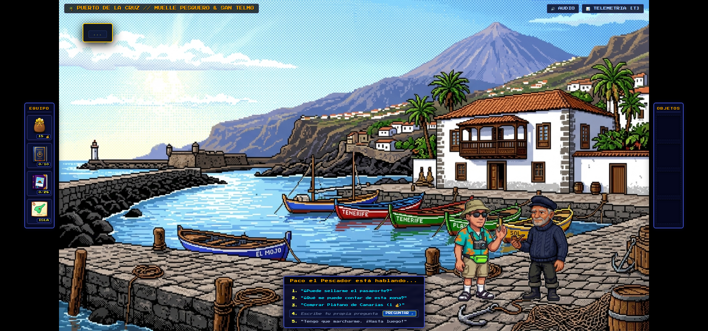

---

### 02. La Orotava (Valle de Taoro & Molino de Chano)
- **NPC:** Chano el Molinero (`X: 75.0%`, `Suelo: 8.0%`) | **Twinber:** `X: 63.5%`
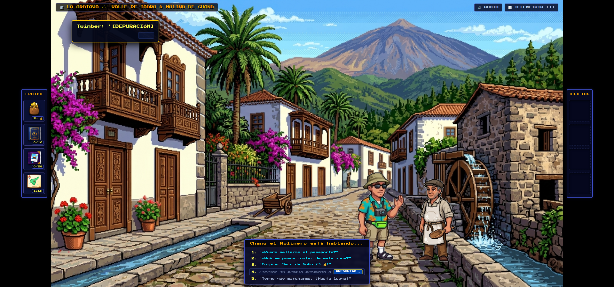

---

### 03. Santa Úrsula (Guachinche & Mar de Nubes)
- **NPC:** Manolo el Tabernero (`X: 72.0%`, `Suelo: 8.0%`) | **Twinber:** `X: 60.5%`
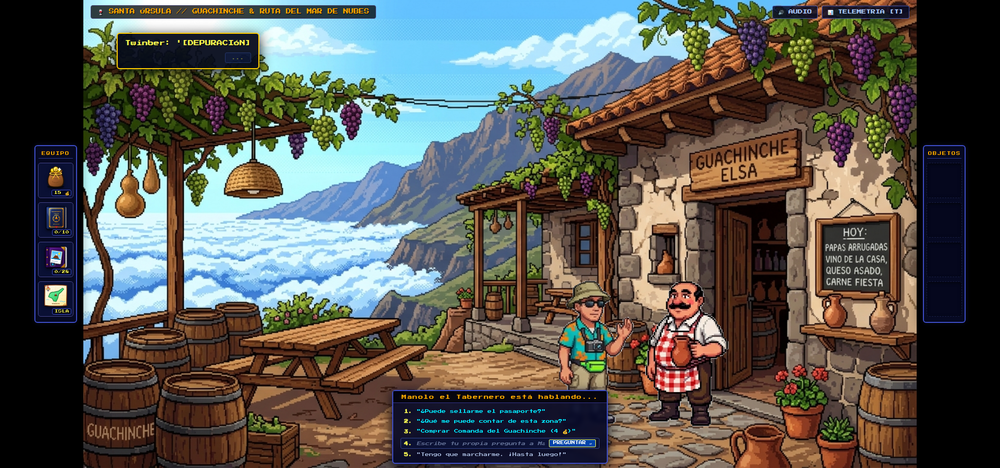

---

### 04. Icod de los Vinos (Drago Milenario & Plaza Mayor)
- **NPC:** Don Cándido el Bodeguero (`X: 56.0%`, `Suelo: 7.0%`) | **Twinber:** `X: 44.5%`
- *Nota:* Centrados en la plaza sobre el pavimento de adoquines, sin tapar el Drago ni el campanario.
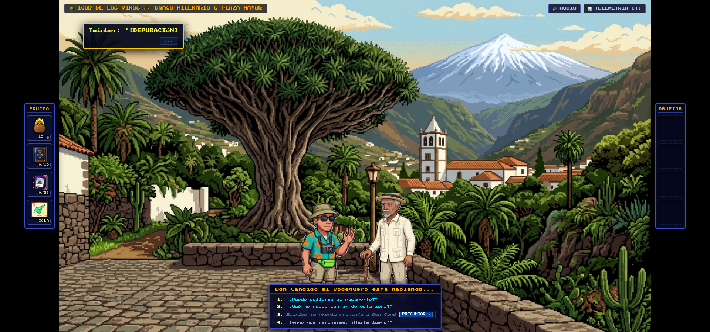

---

### 05. Garachico (El Caletón & Piscinas Naturales)
- **NPC:** Doña Nieves (`X: 74.0%`, `Suelo: 8.0%`) | **Twinber:** `X: 62.5%`
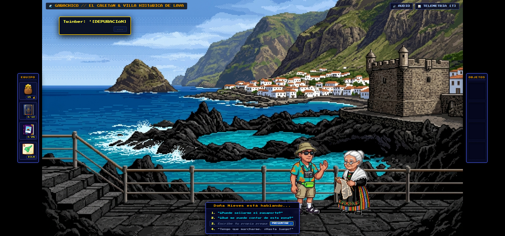

---

### 06. San Cristóbal de La Laguna (Ciudad Universitaria UNESCO)
- **NPC:** Profesora Herminia (`X: 75.0%`, `Suelo: 8.0%`) | **Twinber:** `X: 63.5%`
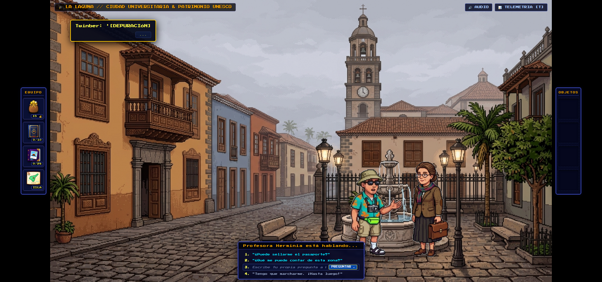

---

### 07. Santa Cruz de Tenerife (Muelle & Comandancia Naval)
- **NPC:** Oficial Morales (`X: 76.0%`, `Suelo: 8.0%`) | **Twinber:** `X: 64.5%`
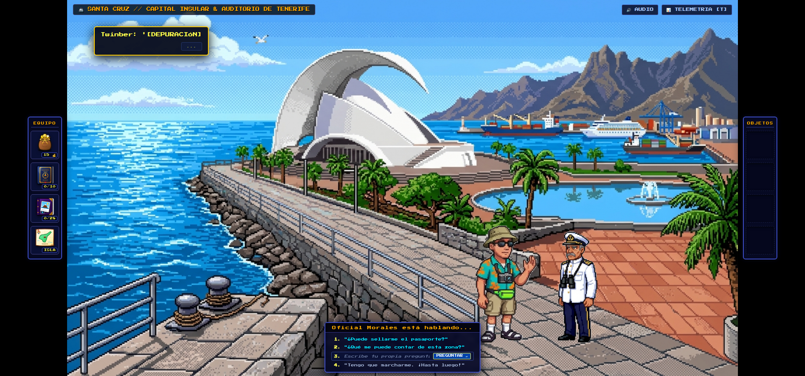

---

### 08. Parque Rural de Anaga (Sendero Bosque de Laurisilva)
- **NPC:** Guarda Forestal Yeray (`X: 74.0%`, `Suelo: 8.0%`) | **Twinber:** `X: 62.5%`
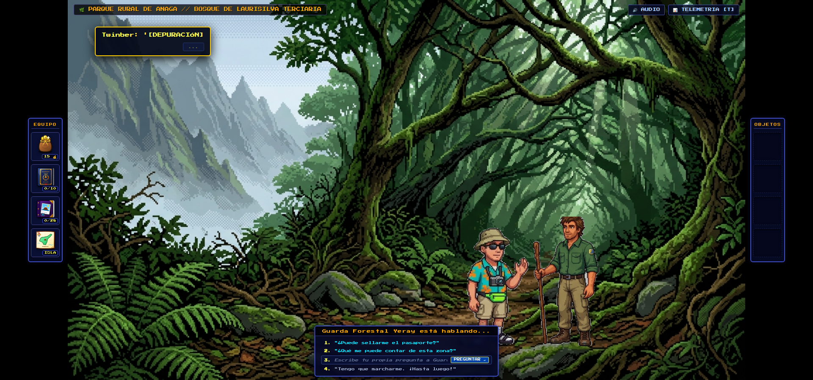

---

### 09. Costa Adeje (Playa del Duque & Paseo Marítimo)
- **NPC:** Ayoze el Socorrista (`X: 76.0%`, `Suelo: 8.0%`) | **Twinber:** `X: 64.5%`
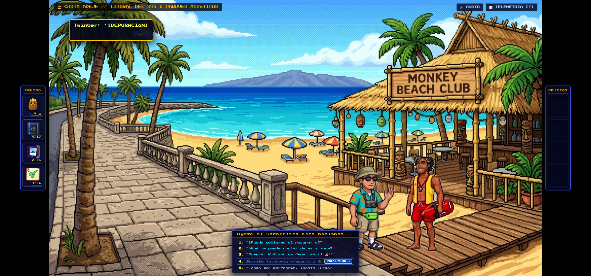

---

### 10. Barranco de Masca (Acantilados de Los Gigantes)
- **NPC:** Tanausú el Guía (`X: 74.0%`, `Suelo: 8.0%`) | **Twinber:** `X: 62.5%`
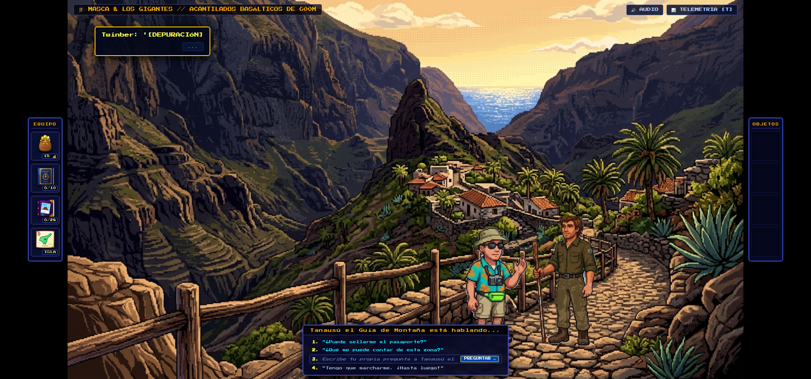

---

### 11. El Médano (Playa & Montaña Roja)
- **NPC:** El Frutero Canario (`X: 75.0%`, `Suelo: 8.0%`) | **Twinber:** `X: 63.5%`
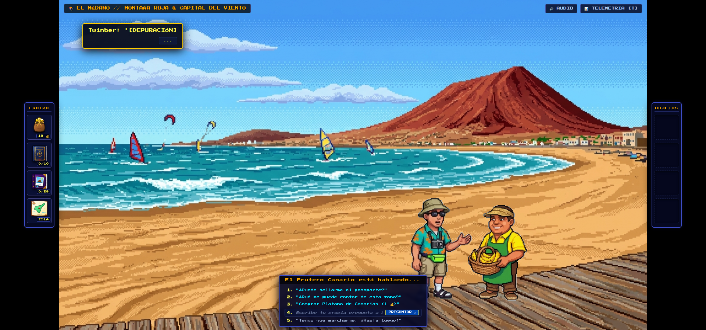

---

### 12. Las Cañadas del Teide (Base del Teleférico)
- **NPC:** Operario del Teleférico (`X: 74.0%`, `Suelo: 8.0%`) | **Twinber:** `X: 62.5%`
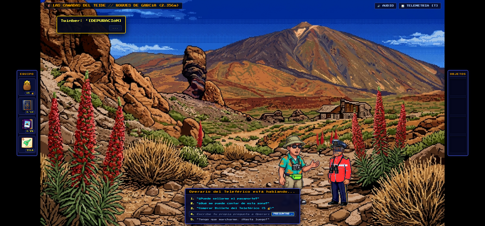

---

### 13. Pico del Teide (3.718m Cumbre & Reserva Starlight)
- **NPC:** El Guardián del Teide (`X: 75.0%`, `Suelo: 8.0%`) | **Twinber:** `X: 63.5%`
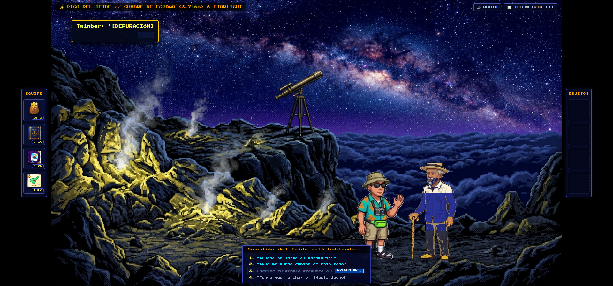
