# 🎯 Auditoría y Calibración Visual de Zonas Calientes (Chroma Key)

Este documento registra la validación visual y técnica de las **zonas calientes interactivas (*hotspots*)** en los 13 enclaves de la aventura gráfica *Twinber en Busca del Secreto Guanche*.

Para garantizar que cada área interactiva se ajuste con precisión a los elementos dibujados en el arte píxel art (16:9), se implementó una **máscara Chroma Key verde fluorescente (`rgba(0, 255, 68, 0.38)`)** con bordes discontinuos y etiquetas identificativas en tiempo real.

---

## 📊 Resumen Ejecutivo de Correcciones Principales

| # | Enclave | Estado Inicial (Detectado) | Corrección y Calibración Aplicada |
|---|---|---|---|
| **01** | **Puerto de la Cruz** | La barca flotaba en el agua y el faro cubría agua vacía; fortín no delimitado. | Barca `"El Mojo"` ajustada al casco azul rotulado; Faro ceñido a la torre blanca del espigón (`4.5% x 9%`); nuevo hotspot para el Fortín histórico de 1780. |
| **02** | **La Orotava** | El Molino de Agua estaba sobre una casa del centro en vez de la rueda hidráulica. | Rueda hidráulica y cascada del molino calibradas a la derecha (`71% x 48%`); balconadas de tea asignadas a la casona señorial izquierda; añadido callejón con acequia de piedra. |
| **03** | **Santa Úrsula** | Las barricas flotaban en el cielo/mar de nubes; el mar de nubes tapaba el tejado del guachinche. | Barricas de roble rotuladas reubicadas en la esquina inferior izquierda (`6% x 62%`); mar de nubes centrado en el valle; entrada y pizarra del Guachinche Elsa delimitadas. |
| **04** | **Icod de los Vinos** | Copa del drago incompleta y la iglesia ascendía hacia el cielo montañoso. | Silueta completa de la copa del Drago Milenario (`38% x 62%`); Iglesia de San Marcos ajustada al campanario y nave; añadido el Teide nevado en cumbre. |
| **05** | **Garachico** | **Inversión severa:** El Castillo de San Miguel cubría el pueblo y la Plaza cubría el castillo. | Castillo de San Miguel (1575) reasignado a la torre de piedra de la derecha (`71% x 22%`); Piscinas de El Caletón ajustadas a las pozas de lava turquesa; añadido el Roque de Garachico. |
| **06** | **La Laguna** | La Torre de la Concepción cubría la fuente central y el suelo; solapamiento. | Torre de la Concepción ceñida al campanario y reloj toscano (`56% x 7%`); Fuente de mármol de Génova independizada; casona colonial UNESCO delimitada a la izquierda. |
| **07** | **Santa Cruz** | **Desfase crítico:** El Auditorio de Calatrava estaba flotando en el mar izquierdo. | Auditorio de Tenerife Adán Martín centrado con precisión sobre el ala blanca curvada (`33% x 20%`); Lago de Plaza de España ajustado a la dársena con surtidores; añadido puerto de cruceros. |
| **08** | **Anaga** | Etiquetas cruzadas entre el túnel de ramas y la panorámica montañosa. | Túnel verde de laurisilva asignado a la bóveda de ramas entrelazadas (`53% x 20%`); Mirador y Crestas de Anaga al claro de niebla; añadidos los helechos gigantes terciarios. |
| **09** | **Costa Adeje** | **Inversión:** El club con letrero "Monkey Beach Club" tenía la etiqueta de Siam Park. | Monkey Beach Club ajustado al chiringuito tropical con su letrero de madera (`63% x 16%`); Playa de Troya ceñida a la arena con sombrillas; paseo marítimo de Las Américas delimitado. |
| **10** | **Masca** | **Inversión:** Las casas del caserío estaban rotuladas como acantilados y viceversa. | Caserío tradicional de Masca ajustado al conjunto de casas y palmeras de la loma (`51% x 39%`); Barranco y acantilados basálticos delimitados en la vertiginosa garganta izquierda (`18% x 20%`). |
| **11** | **El Médano** | **Inversión:** Montaña Roja estaba sobre los kitesurfistas y la bahía sobre la montaña. | Cono volcánico rojizo de Montaña Roja delimitado en la derecha (`60% x 20%`); bahía de kitesurf y windsurf asignada a las aguas con velas; playa de dunas fósiles calibrada. |
| **12** | **Las Cañadas** | Rectángulo genérico difuso; no se delimitaba el Roque Cinchado ni los tajinastes. | Roque Cinchado ("Árbol de Piedra") aislado con exactitud (`35% x 26%`, `9% x 22%`); estratovolcán Teide delimitado; añadidos los espectaculares Tajinastes Rojos florales en primer término. |
| **13** | **Pico del Teide** | Cráter solapaba el cielo y el telescopio no tenía interacción diferenciada. | Telescopio astronómico en el risco aislado en su trípode (`44% x 28%`); cráter somital y fumarolas sulfurosas calibrados; bóveda celeste y Vía Láctea delimitadas. |

---

## 🖼️ Evidencias Gráficas Escenario por Escenario

### 01. Puerto de la Cruz (`puerto_cruz`)
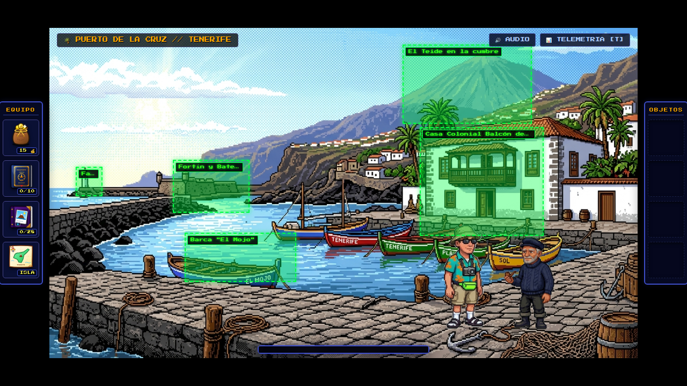

* **Faro de San Telmo:** `left: 4.5%`, `top: 42%`, `width: 4.5%`, `height: 9%` — Torreta cilíndrica blanca en el extremo del espigón pesquero.
* **Fortín y Batería de San Telmo:** `left: 21%`, `top: 40%`, `width: 13%`, `height: 16%` — Batería defensiva amurallada sobre el acantilado (1780).
* **Barca "El Mojo":** `left: 23%`, `top: 62%`, `width: 19%`, `height: 15%` — Barca de madera azul amarrada en primer plano rotulada "EL MOJO".
* **Casa Colonial Balcón de Tea:** `left: 63%`, `top: 30%`, `width: 21%`, `height: 33%` — Mansión señorial canaria de dos plantas con mirador y celosía de tea.
* **El Teide en la cumbre:** `left: 60%`, `top: 5%`, `width: 22%`, `height: 24%` — Silueta del estratovolcán elevándose sobre las nubes a 3.718m.

---

### 02. La Orotava (`la_orotava`)
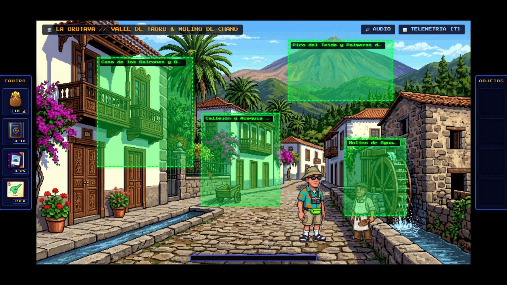

* **Casa de los Balcones y Balconadas:** `left: 14%`, `top: 15%`, `width: 22%`, `height: 45%` — Balcones tallados de tea canaria y buganvillas en la fachada señorial.
* **Molino de Agua de Gofio:** `left: 71%`, `top: 48%`, `width: 14%`, `height: 32%` — Rueda hidráulica de madera impulsada por el torrente de agua entre los muros de cantería.
* **Callejón y Acequia del Agua:** `left: 38%`, `top: 38%`, `width: 18%`, `height: 38%` — Vía empedrada con carro tradicional y canal de piedra natural de manantial.
* **Pico del Teide y Palmeras de Taoro:** `left: 58%`, `top: 8%`, `width: 24%`, `height: 25%` — Vista de la cumbre nevada coronando el valle entre palmeras.

---

### 03. Santa Úrsula (`santa_ursula`)
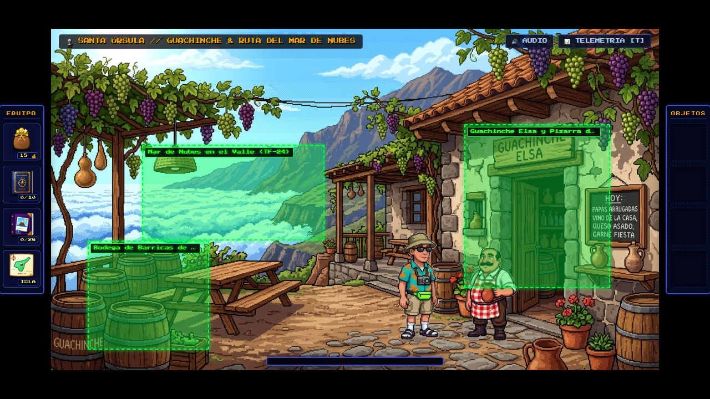

* **Bodega de Barricas de Roble:** `left: 6%`, `top: 62%`, `width: 20%`, `height: 32%` — Toneles vinícolas de roble con el sello "GUACHINCHE" en el rincón del lagar.
* **Mar de Nubes en el Valle (TF-24):** `left: 15%`, `top: 34%`, `width: 30%`, `height: 28%` — Alfombra blanca de condensación de alisios a 1.200 metros sobre el valle.
* **Guachinche Elsa y Pizarra de Platos:** `left: 68%`, `top: 28%`, `width: 24%`, `height: 48%` — Entrada de piedra, rótulo de madera y pizarra con el menú tradicional canario.

---

### 04. Icod de los Vinos (`icod`)
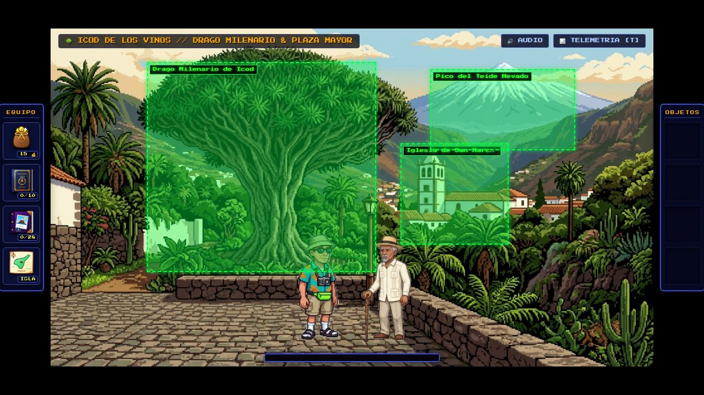

* **Drago Milenario de Icod:** `left: 16%`, `top: 10%`, `width: 38%`, `height: 62%` — Enorme dosel arbóreo en abanico y tronco multiramificado de más de 800 años.
* **Iglesia de San Marcos:** `left: 58%`, `top: 34%`, `width: 18%`, `height: 30%` — Campanario blanco toscano y techumbre del templo del siglo XVI.
* **Pico del Teide Nevado:** `left: 63%`, `top: 12%`, `width: 24%`, `height: 24%` — Cumbre nevada del Teide dominando el horizonte norteño.

---

### 05. Garachico (`garachico`)
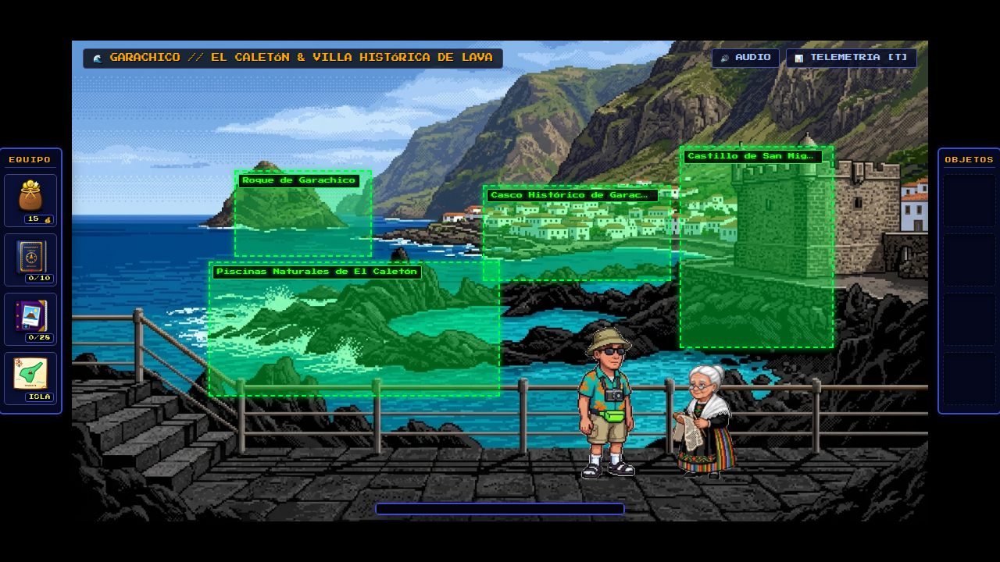

* **Castillo de San Miguel (1575):** `left: 71%`, `top: 22%`, `width: 18%`, `height: 42%` — Fortaleza cuadrangular defensiva de cantería oscura que sobrevivió a la erupción de 1706.
* **Piscinas Naturales de El Caletón:** `left: 16%`, `top: 46%`, `width: 34%`, `height: 28%` — Pozas marinas esculpidas por la lava basáltica con oleaje rompiente.
* **Roque de Garachico:** `left: 19%`, `top: 27%`, `width: 16%`, `height: 18%` — Farallón basáltico sagrado emergente en el océano Atlántico.
* **Casco Histórico de Garachico:** `left: 48%`, `top: 30%`, `width: 22%`, `height: 20%` — Pueblo blanco renacido de las cenizas al otro lado de la bahía.

---

### 06. San Cristóbal de La Laguna (`la_laguna`)
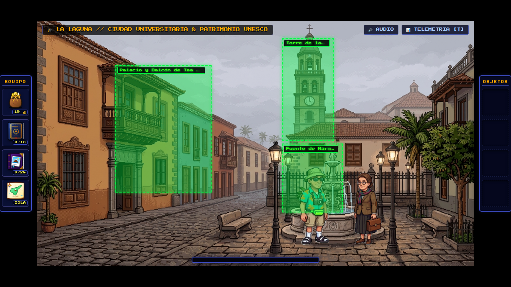

* **Torre de la Concepción:** `left: 56%`, `top: 7%`, `width: 12%`, `height: 42%` — Esbelto campanario toscano de piedra vista y reloj histórico de la ciudad universitaria.
* **Fuente de Mármol de Génova:** `left: 56%`, `top: 50%`, `width: 14%`, `height: 28%` — Fuente renacentista labrada con surtidor en la plaza empedrada.
* **Palacio y Balcón de Tea (UNESCO):** `left: 18%`, `top: 18%`, `width: 22%`, `height: 52%` — Portada señorial y balconada de tea sobre la calzada colonial.

---

### 07. Santa Cruz de Tenerife (`santa_cruz`)
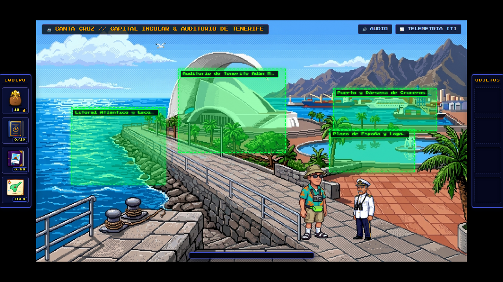

* **Auditorio de Tenerife Adán Martín:** `left: 33%`, `top: 20%`, `width: 25%`, `height: 35%` — Ala escultural blanca de hormigón diseñada por Santiago Calatrava junto al mar.
* **Plaza de España y Lago Central:** `left: 68%`, `top: 45%`, `width: 20%`, `height: 18%` — Espejo de agua marina y surtidores de los arquitectos Herzog & de Meuron.
* **Puerto y Dársena de Cruceros:** `left: 69%`, `top: 28%`, `width: 24%`, `height: 18%` — Transatlánticos, ferrys de Fred Olsen / Naviera Armas y grúas de estiba portuaria.
* **Litoral Atlántico y Escollera:** `left: 8%`, `top: 36%`, `width: 22%`, `height: 32%` — Ribera marítima abierta con noráis y dique de protección costera.

---

### 08. Parque Rural de Anaga (`anaga`)
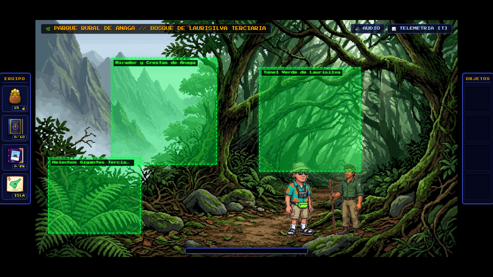

* **Túnel Verde de Laurisilva:** `left: 53%`, `top: 20%`, `width: 24%`, `height: 44%` — Pasillo vegetal de ramas cubiertas de musgo y líquenes terciarios entrelazados.
* **Mirador y Crestas de Anaga:** `left: 18%`, `top: 16%`, `width: 25%`, `height: 45%` — Garganta abierta hacia los afilados roques volcánicos entre la bruma de los alisios.
* **Helechos Gigantes Terciarios:** `left: 3%`, `top: 58%`, `width: 22%`, `height: 32%` — Frondoso sotobosque fósil de helechos relictos en el suelo forestal húmedo.

---

### 09. Costa Adeje & Las Américas (`costa_adeje`)
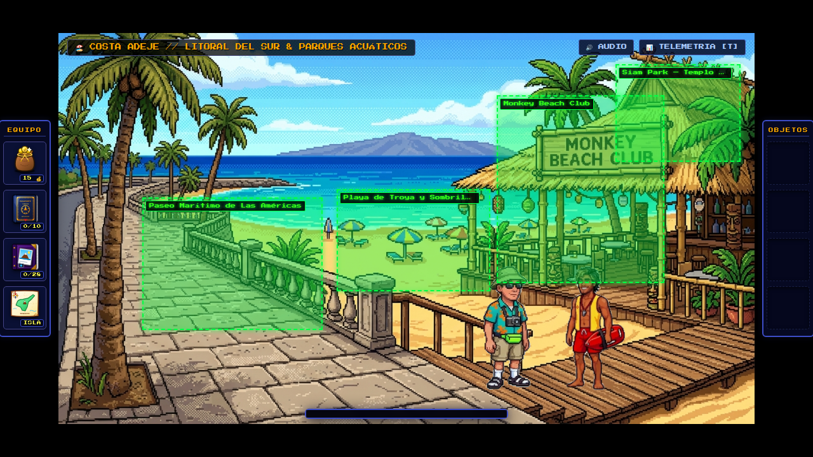

* **Monkey Beach Club:** `left: 63%`, `top: 16%`, `width: 24%`, `height: 48%` — Chiringuito tropical de madera y techumbre vegetal con el rótulo "MONKEY BEACH CLUB".
* **Playa de Troya y Sombrillas:** `left: 40%`, `top: 40%`, `width: 22%`, `height: 26%` — Playa de arena dorada con sombrillas azules frente a las aguas tranquilas del sur.
* **Paseo Marítimo de Las Américas:** `left: 12%`, `top: 42%`, `width: 26%`, `height: 34%` — Avenida costera empedrada con balaustrada de piedra blanca y cocoteros.
* **Siam Park — Templo del Agua:** `left: 80%`, `top: 8%`, `width: 18%`, `height: 25%` — Remate superior que mantiene la vinculación fotográfica RAG #24.

---

### 10. Los Gigantes & Masca (`masca`)
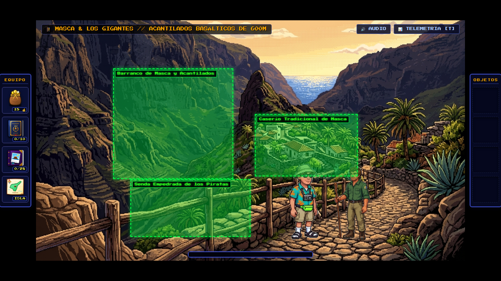

* **Caserío Tradicional de Masca:** `left: 51%`, `top: 39%`, `width: 24%`, `height: 26%` — Conjunto de casas de piedra y palmeras canarias aferradas a la cresta rocosa del caserío.
* **Barranco de Masca y Acantilados:** `left: 18%`, `top: 20%`, `width: 28%`, `height: 46%` — Colosales murallas basálticas de caída vertical hacia el fondo del abismo.
* **Senda Empedrada de los Piratas:** `left: 22%`, `top: 66%`, `width: 28%`, `height: 24%` — Camino de herradura con barandilla rústica de madera en primer plano.

---

### 11. El Médano & Montaña Roja (`el_medano`)
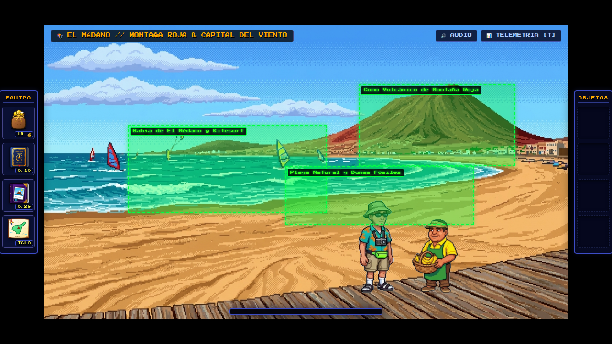

* **Cono Volcánico de Montaña Roja:** `left: 60%`, `top: 20%`, `width: 30%`, `height: 28%` — Silueta del cráter volcánico de tonos rojizos y ocres junto a la playa virgen.
* **Bahía de El Médano y Kitesurf:** `left: 16%`, `top: 34%`, `width: 38%`, `height: 30%` — Aguas turquesa batidas por el viento con velas de windsurf y cometas de kitesurf.
* **Playa Natural y Dunas Fósiles:** `left: 46%`, `top: 48%`, `width: 36%`, `height: 20%` — Extensión de arena rubia moldeada constantemente por los alisios del sur.

---

### 12. Las Cañadas del Teide (`las_canadas`)
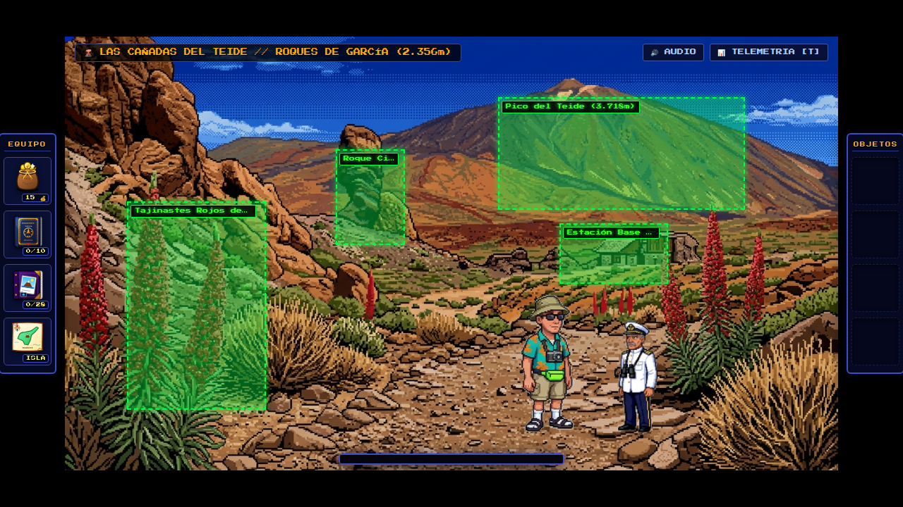

* **Roque Cinchado (Roques de García):** `left: 35%`, `top: 26%`, `width: 9%`, `height: 22%` — Aguja esbelta de lava del icónico "Árbol de Piedra" (antiguo billete de 1.000 pesetas).
* **Pico del Teide (3.718m):** `left: 56%`, `top: 14%`, `width: 32%`, `height: 26%` — Cumbre y cono terminal del volcán nevado sobre el Llano de Ucanca.
* **Tajinastes Rojos de Las Cañadas:** `left: 8%`, `top: 38%`, `width: 18%`, `height: 48%` — Altas inflorescencias rojas endémicas (*Echium wildpretii*) en floración en la ladera izquierda.
* **Estación Base del Teleférico (2.356m):** `left: 64%`, `top: 43%`, `width: 14%`, `height: 14%` — Edificio de piedra de la estación mecánica de abordaje hacia La Rambleta.

---

### 13. Pico del Teide — 3.718m (`pico_teide`)
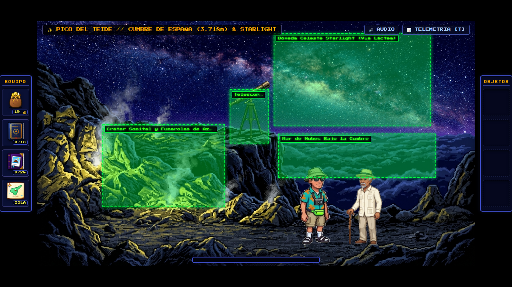

* **Telescopio Astronómico en el Risco:** `left: 44%`, `top: 28%`, `width: 9%`, `height: 22%` — Catalejo astronómico de latón montado sobre su trípode en la cornisa volcánica.
* **Cráter Somital y Fumarolas de Azufre:** `left: 15%`, `top: 42%`, `width: 28%`, `height: 34%` — Grietas volcánicas de azufre amarillo con penachos de vapor caliente a 3.718m.
* **Bóveda Celeste Starlight (Vía Láctea):** `left: 54%`, `top: 5%`, `width: 36%`, `height: 38%` — Núcleo brillante y nítido de la galaxia sobre el cielo nocturno impoluto de cumbre.
* **Mar de Nubes Bajo la Cumbre:** `left: 55%`, `top: 46%`, `width: 36%`, `height: 18%` — Manto continuo de nubes que aísla la cima de España bajo el cosmos.
